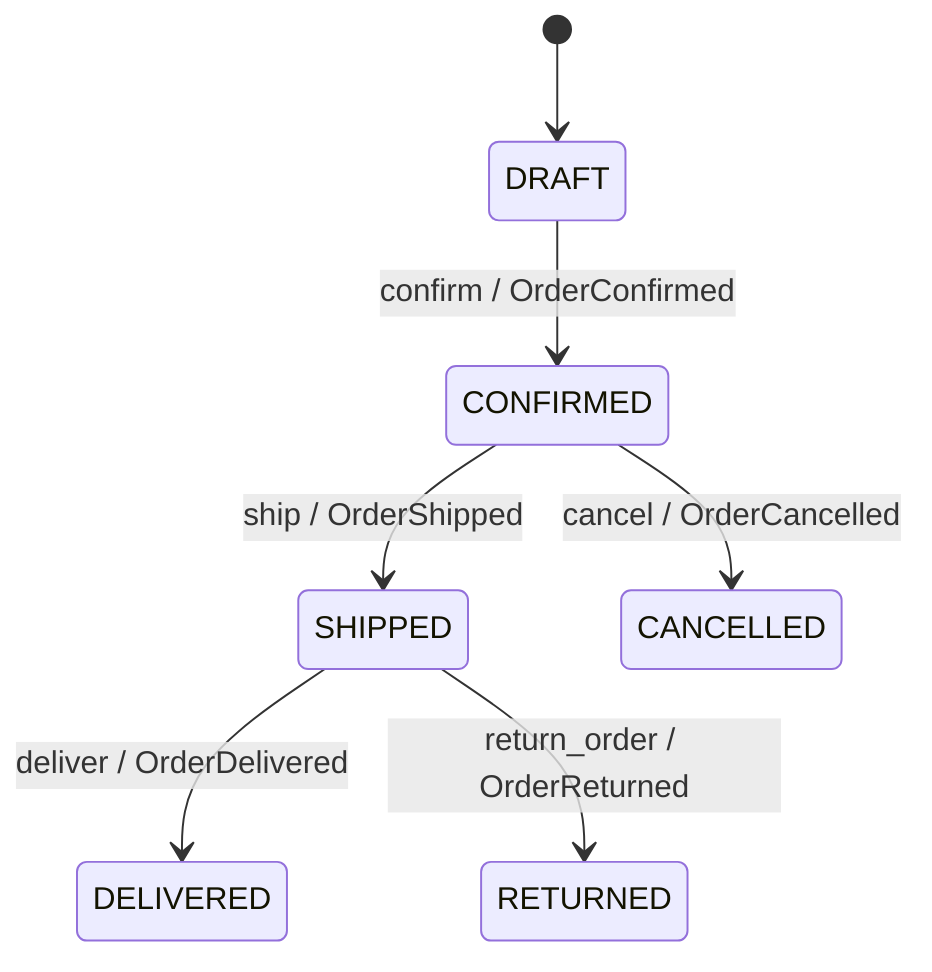

# TechStore U4

Proyecto de la Actividad 4 para administrar pedidos ficticios con Python 3.11+, FastAPI y pytest. Lee los datos del paquete CSV, crea objetos del dominio en memoria, evalúa descuentos con Specifications y aplica transiciones mediante operaciones REST.

## Requisitos

- Python 3.11 o posterior
- pip

## Instalación

Desde la carpeta raíz del proyecto:

```bash
python -m venv .venv
```

Activa el entorno:

```powershell
# Windows PowerShell
.venv\Scripts\Activate.ps1
```

```bash
# macOS o Linux
source .venv/bin/activate
```

Instala las dependencias:

```bash
python -m pip install -r requirements.txt
```

## Carga y verificación

Los archivos `cargar_csv.py` y `datos/` se copiaron del paquete del alumno y están junto a `app/`.

```bash
python cargar_csv.py
python -m app.scenarios
python -m pytest -q
```

La salida de referencia de esas ejecuciones se guarda en `evidencias/`. El cargador debe mostrar 16 pedidos en estado DRAFT; por ejemplo, O001 tiene 4 unidades y un total de 2100.00 MXN.

## Reglas del dominio

- `Money` es inmutable, usa `Decimal` y rechaza importes negativos, no finitos y valores `float`.
- `OrderItem` calcula su subtotal. El total y el límite suman cantidades, no renglones.
- Un pedido admite como máximo 20 unidades en total. No se descuenta ni reserva inventario; `existencia` se conserva como dato del catálogo.
- Todos los pedidos del fixture comienzan en `DRAFT`.
- El descuento de 10% exige cliente VIP, total estrictamente mayor que 500 MXN, al menos 4 unidades y ninguna promoción activa.
- El descuento de 5% exige total estrictamente mayor que 5000 MXN y ninguna promoción activa. Si ambas reglas aplican, se usa 10%.
- El repositorio es en memoria: reiniciar el proceso recarga los CSV y descarta los cambios.

## Estados y eventos



Cada operación valida sus precondiciones antes de cambiar el estado. Solo una transición válida añade su evento. No se permite cancelar un pedido `SHIPPED`.

## API REST

Inicia el servicio:

```bash
uvicorn app.api:app --reload
```

La documentación interactiva está en <http://127.0.0.1:8000/docs> y el esquema OpenAPI en <http://127.0.0.1:8000/openapi.json>.

| Método | Ruta | Uso |
| --- | --- | --- |
| `GET` | `/orders/{id}` | Consultar pedido, total, descuento y eventos |
| `POST` | `/orders/{id}/confirm` | Confirmar un pedido |
| `POST` | `/orders/{id}/ship` | Enviar con JSON `{"tracking_number":"TRK-1"}` |
| `POST` | `/orders/{id}/cancel` | Cancelar con JSON `{"reason":"motivo"}` |
| `POST` | `/orders/{id}/deliver` | Registrar entrega |
| `POST` | `/orders/{id}/return` | Registrar devolución |

Respuestas relevantes: `404` si el pedido no existe, `409` para una transición inválida y `422` para datos inválidos o una regla de dominio incumplida.

## Estructura

```text
techstore-u4/
├── app/
│   ├── api.py
│   ├── domain.py
│   ├── scenarios.py
│   └── specifications.py
├── datos/
├── docs/
├── evidencias/
├── tests/
├── cargar_csv.py
├── requirements.txt
└── README.md
```

## Entrega

La bitácora (estado inicial, precondiciones, operación, resultado, evento y prueba para E01–E15 está en `docs/bitacora_escenarios.md`. `docs/guia_y_reflexion.md` resume el diseño y ofrece respuestas base a las preguntas del manual. Las evidencias de texto quedan en `evidencias/`; las capturas de Swagger y del repositorio GitHub deben tomarse en el navegador o equipo donde se presente la entrega.
